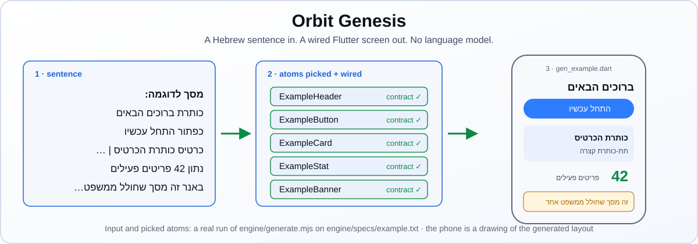
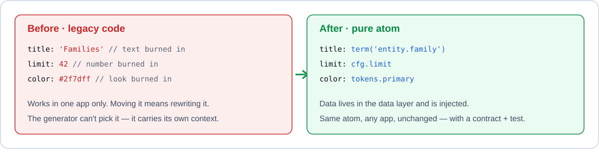
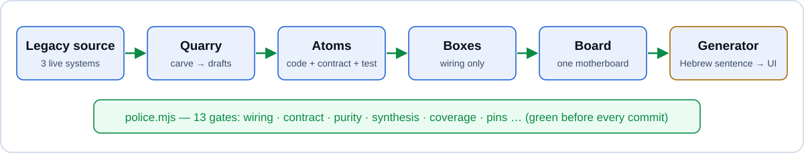
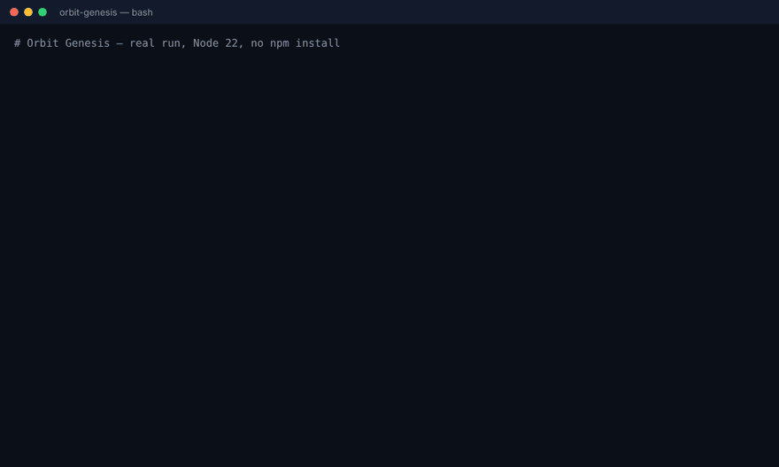
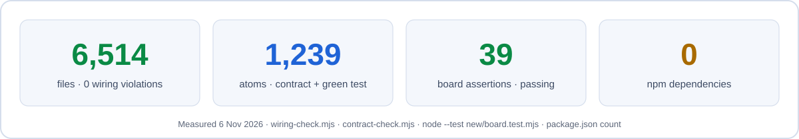
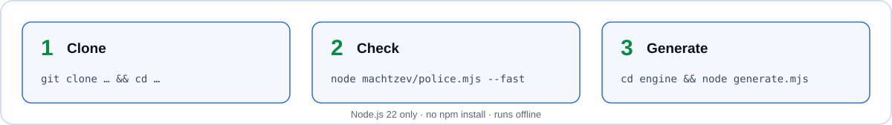

<p align="right"><a href="README.md">עברית</a> · <b>English</b></p>

<p align="center"><b>⚡ Try it now</b> — one command, ~2 seconds, Node 22 only (<a href="#see-it-run">see the GIF</a>):</p>

```bash
git clone --depth 1 https://github.com/meir7651231-ui/-ai-chat-server orbit && cd orbit/engine && node generate.mjs
```

<p align="center"><picture><source media="(prefers-color-scheme: dark)" srcset="assets/hero.svg"></picture></p>

<p align="center">


</p>

<h3 align="center">Every wire has a contract. Nothing burned in. No capability lost.</h3>

<p align="center"><a href="#the-problem">The problem</a> · <a href="#how-it-works">How it works</a> · <a href="#see-it-run">Demo</a> · <a href="#the-numbers">The numbers</a> · <a href="#whats-inside">What's inside</a> · <a href="#what-it-does-not-do">What it does not do</a> · <a href="#quick-start--60-seconds">Quick start</a> · <a href="#docs">Docs</a> · <a href="#status">Status</a> · <a href="#faq">FAQ</a></p>

---

## The problem

Three live systems — **maor**, **buildsmart** and **yoman** — grew fast, and each one burned text, numbers and context into its own code.
That code works, but no part of it can move to another project unchanged, and no new feature can be assembled from it automatically.

**Orbit Genesis is the clean rebuild.** The old code was broken into tens of thousands of registered atoms; here a new tree is built only
from pure atoms and wiring boxes — on the way to **the generator**: a Hebrew sentence ⇒ a feature assembled from the catalog.

<p align="center"><picture><source media="(prefers-color-scheme: dark)" srcset="assets/beforeafter.svg"></picture></p>

## How it works

<p align="center"><picture><source media="(prefers-color-scheme: dark)" srcset="assets/how.svg"></picture></p>

1. **Quarry** (`machtzev/`) — carves atom drafts out of the legacy source.
2. **Atom** (`new/atoms/`) — one pure capability: code + contract + test, with no data inside (see `PURPOSE.md`).
3. **Box** (`new/boxes/`) — wiring between atoms, nothing else.
4. **Board** (`new/board.*`) — the motherboard that joins the boxes into one system.
5. **Generator** (`engine/`) — a deterministic engine that turns a Hebrew sentence into a Flutter screen, with no language model.
6. **Police** (`machtzev/police.mjs`) — 13 gates (wiring, contract, purity, synthesis, coverage, pins and more) that must be green before every commit.

Checked detail: [`docs/ARCHITECTURE.md`](docs/ARCHITECTURE.md) · the laws (Hebrew): [`LAW.md`](LAW.md) · the goal (Hebrew): [`PURPOSE.md`](PURPOSE.md).

## See it run

A recording of a real run (6 Nov 2026, Node 22, no `npm install`): wiring check → contract check → board test → the generator reads a sentence and writes a Dart screen.

<p align="center"></p>

## The numbers

<p align="center"><picture><source media="(prefers-color-scheme: dark)" srcset="assets/numbers.svg"></picture></p>

Every number here was measured by a run, not estimated. The commands are under [Quick start](#quick-start--60-seconds).

## What's inside

| Folder / file | What it holds |
|---|---|
| `new/` | The new tree: atoms, boxes, board and Dart layers |
| `machtzev/` | Quarry and police: extraction, checks, lessons (`LEARNINGS.md`), decisions (`DECISIONS.md`) |
| `engine/` | The generator — sentence ⇒ screen ([README](engine/README.md)) |
| `runtime/` | Dart runtime for the atoms |
| `box-drafts/` | Box plans and the readiness meter (`READINESS.md`) |
| `dart-from-maor/` · `dart-quarry/` | Dart drafts converted from the source |
| `screens-seed/` | Screen seeds for assembly |
| `design/` | Orbit design and brand pages |
| `knowledge/` | Plans, summaries and close-out notes |
| `docs/` | Architecture, the generator guide, and `handoff/` — hand-off notes nothing else links to |
| `.github/` | Issue and PR templates (no workflows) |
| `meron/` | Topic-by-topic planning file for managing the Meron event (HTML, one topic per file) |
| `WIRING.md` | The live wiring map (generated — do not edit by hand) |
| `HANDOFF-MASTER.md` · `HANDOFF-DART-CONVERSION.md` | Hand-off notes other documents link to (they stay at the root) |

## What it does not do

- **It is not a server or a running app.** There is no service to deploy; this is a code tree, tools and checks.
- **The generator uses no language model** and does not "understand" free Hebrew — each line starts with a shape word (`כפתור` button, `כרטיס` card…) that a lexicon (`lexicon.json`) maps to a catalog atom. A shape word not in the lexicon is not mapped.
- **It does not replace the live systems.** maor, buildsmart and yoman keep running from their own repos; the cutover is planned to be reversible (law 7).
- **It does not promise that a generated screen passes `flutter analyze` here** — the compile test runs inside buildsmart, not in this repo.
- **It holds no secrets, identities or connections** — those are injected at deploy time (law 6).
- **There is no CI yet** — checks are run by hand or in a session.

## Quick start · 60 seconds

<p align="center"><picture><source media="(prefers-color-scheme: dark)" srcset="assets/install.svg"></picture></p>

Node.js 22 only. There is no `npm install` — the tools use Node's built-in modules only.

```bash
git clone --depth 1 https://github.com/meir7651231-ui/-ai-chat-server orbit && cd orbit

(cd engine && node generate.mjs)         # the generator: sentence ⇒ screen
node machtzev/wiring-check.mjs ./new     # wiring laws on the new tree
node --test new/board.test.mjs           # board test
node machtzev/contract-check.mjs ./new   # every atom: contract + green test
node machtzev/police.mjs --fast          # the fast police (before every commit)
```

**Measured on 6 Nov 2026** from a clean clone, Node 22.23, a 4-core machine:

| Step | Time |
|---|---|
| `git clone --depth 1` | 2.3 s |
| Generator | 0.05 s |
| Wiring check | 0.2 s |
| Board test | 0.15 s |
| Contract check (runs 1,239 tests) | 40.6 s |
| **Total, clone to four green checks** | **about 44 s** |

`police.mjs --fast` is not in the timing — it is red right now (see [Status](#status)).

Want your own screen? [`docs/GENERATOR.md`](docs/GENERATOR.md).

## Docs

| Document | What it holds |
|---|---|
| [`docs/ARCHITECTURE.md`](docs/ARCHITECTURE.md) | The layers, the laws and the generator — checked facts only |
| [`docs/GENERATOR.md`](docs/GENERATOR.md) | Short guide: your own screen in a minute |
| [`ROADMAP.md`](ROADMAP.md) | What is done, in progress and planned |
| [`CONTRIBUTING.md`](CONTRIBUTING.md) | How to contribute — branches, contracts, police |
| [`CHANGELOG.md`](CHANGELOG.md) | Milestones |
| [`SECURITY.md`](SECURITY.md) | Public repo, no secrets, private reporting |
| [`LAW.md`](LAW.md) · [`PURPOSE.md`](PURPOSE.md) | The constitution and the goal (Hebrew) |

## Status

- 🧊 **Feature freeze** (owner decision D5, November 2026) — fixes, order and docs only.
- ✅ Wiring: 6,514 files, zero violations · ✅ Contracts: 1,239 atoms · ✅ Board: 39 assertions pass.
- 🔴 `police.mjs --fast` is currently red at the synthesis gate (JS↔Dart equivalence). The fix waits in draft PRs #2–#4.
- Main working branch: `claude/mah-kora-0by8kw`. The repo has no automated CI yet.
- Next: [`ROADMAP.md`](ROADMAP.md) · History: [`CHANGELOG.md`](CHANGELOG.md) · Security: [`SECURITY.md`](SECURITY.md).

## FAQ

<details><summary><b>Why is there no legacy code here?</b></summary>

The repo was born empty on 24 Aug 2026. Every file came in through the quarry, with a contract and a test. The old code stays in the original repos.
</details>

<details><summary><b>What is a "pure atom"?</b></summary>

A unit of code that does one thing and holds no burned-in data — no text, no fixed number, no name. Data is injected from the data layer, so the same atom serves any purpose unchanged.
</details>

<details><summary><b>Does the generator use a language model?</b></summary>

No. The engine in `engine/` is deterministic: the same sentence gives the same output, offline, at no cost per run.
</details>

<details><summary><b>How is the police here different from agent-police?</b></summary>

`machtzev/police.mjs` is this repo's own build police: 13 gates, from wiring and contracts to purity and pins. It is not a separate product or plugin.
</details>

<details><summary><b>Why is the police red if wiring and contracts are green?</b></summary>

The synthesis gate compares JS output with Dart output, and there is a gap in how lists print (`[א, ח, ת]` vs `א,ח,ת`). That is the checker, not an atom — the fix waits for approval in PRs #2–#4.
</details>

<details><summary><b>Why doesn't the repo name match the content?</b></summary>

The name is left over from an early setup. Renaming is a repo setting and waits for the owner's decision.
</details>

<details><summary><b>Where do I start reading?</b></summary>

`LAW.md` → `machtzev/LEARNINGS.md` → `machtzev/AGENT-CODE.md` → `machtzev/DECISIONS.md`. The full order is in `CLAUDE.md`.
</details>
