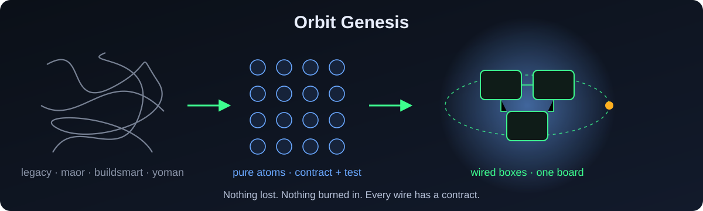
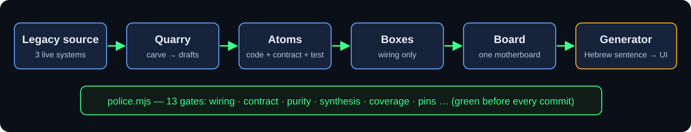

<p align="right"><b>עברית</b> · <a href="README.en.md">English</a></p>

<p align="center"></p>

<p align="center">


</p>

<h3 align="center" dir="rtl">כל חוט עם חוזה. שום דאטה צרובה. שום יכולת לא הולכת לאיבוד.</h3>

<p align="center" dir="rtl"><a href="#הבעיה">הבעיה</a> · <a href="#איך-זה-עובד">איך זה עובד</a> · <a href="#מה-בפנים">מה בפנים</a> · <a href="#הרצה-מקומית">הרצה מקומית</a> · <a href="#סטטוס">סטטוס</a> · <a href="#שאלות-נפוצות">שאלות</a></p>

---

<div dir="rtl">

## הבעיה

שלוש מערכות חיות — **maor**, **buildsmart** ו-**yoman** — גדלו מהר, וכל אחת צרבה בתוך הקוד שלה טקסטים, מספרים והקשר.
קוד כזה עובד, אבל אי אפשר להעביר חלק ממנו לפרויקט אחר בלי לשנות אותו, ואי אפשר להרכיב ממנו פיצ'ר חדש באופן אוטומטי.

**Orbit Genesis הוא הבנייה-מחדש הנקייה:** הקוד הישן פורק לעשרות אלפי אטומים רשומים, וכאן נבנה עץ חדש רק מאטומים טהורים
וקופסאות חיווט — לקראת **המחולל**: משפט בעברית ⇒ פיצ'ר מורכב מהקטלוג.

## איך זה עובד

<p align="center"></p>

1. **מחצבה** (`machtzev/`) — מחלצת מהמקור הישן טיוטות-אטומים.
2. **אטום** (`new/atoms/`) — יכולת טהורה אחת: קוד + חוזה + בדיקה. בלי דאטה בתוכו (ראו `PURPOSE.md`).
3. **קופסה** (`new/boxes/`) — רק חיווט בין אטומים.
4. **לוח-אם** (`new/board.*`) — מחבר את הקופסאות למערכת אחת.
5. **המחולל** (`engine/`) — מנוע דטרמיניסטי שממיר משפט בעברית למסך Flutter, בלי מודל-שפה.
6. **המשטרה** (`machtzev/police.mjs`) — שערי חיווט, חוזה, מחצבה וחתימות שחייבים להיות ירוקים לפני כל commit.

החוקים המלאים: [`LAW.md`](LAW.md) (שבעת חוקי-החשמלאי) · [`PURPOSE.md`](PURPOSE.md) (מטרת-הטיהור).

## מה בפנים

| תיקייה / קובץ | מה יש שם |
|---|---|
| `new/` | העץ החדש: אטומים, קופסאות, לוח-אם, ושכבות Dart |
| `machtzev/` | המחצבה והמשטרה: חילוץ, בדיקות, לקחים (`LEARNINGS.md`), הכרעות (`DECISIONS.md`) |
| `engine/` | המחולל — משפט ⇒ מסך ([README](engine/README.md)) |
| `runtime/` | ריצת-Dart של האטומים |
| `box-drafts/` | תוכניות-קופסה ומד-מוכנות (`READINESS.md`) |
| `dart-from-maor/` · `dart-quarry/` | טיוטות Dart שהומרו מהמקור |
| `screens-seed/` | זרעי-מסכים להרכבה |
| `design/` | עמודי עיצוב ומיתוג של Orbit |
| `knowledge/` | תוכניות, סיכומים ומסמכי סגירה |
| `meron/` | תיק-תכנון נושאי לניהול אירוע מירון (HTML, נושא לקובץ) — [README](meron/README.md) |
| `WIRING.md` | מפת-החיווט החיה (מחוללת אוטומטית — לא לערוך ידנית) |
| `HANDOFF-*.md` | מסמכי העברה בין סשנים |

## הרצה מקומית

דרוש Node.js 22 בלבד. אין `npm install` — הכלים משתמשים רק במודולים המובנים של Node.

</div>

```bash
git clone <כתובת-הריפו> && cd <תיקיית-הריפו>

node machtzev/wiring-check.mjs ./new     # חוקי-החיווט על העץ החדש
node machtzev/contract-check.mjs ./new   # לכל אטום: חוזה + בדיקה ירוקה
node --test new/board.test.mjs           # בדיקת לוח-האם
node machtzev/police.mjs --fast          # המשטרה המהירה (לפני כל commit)
(cd engine && node generate.mjs)         # המחולל על ה-specs שבתיקייה
```

<div dir="rtl">

כל הפקודות האלה הורצו ב-6.11.2026 על Node 22.23.

## סטטוס

- 🧊 **הקפאת פיצ'רים** (הכרעת-בעלים D5, נובמבר 2026) — עבודה רק על תיקונים, סדר ותיעוד.
- ✅ חיווט: 6,514 קבצים בעץ החדש, אפס הפרות · ✅ חוזה: 1,239 אטומים, לכולם חוזה ובדיקה ירוקה · ✅ לוח-אם: בדיקות עוברות.
- 🔴 `police.mjs --fast` אדום כרגע בשער-הסינתזה (שקילות JS↔Dart). התיקון ממתין ב-PRs טיוטה #2–#4.
- ענף-העבודה הראשי: `claude/mah-kora-0by8kw`. אין כרגע CI אוטומטי בריפו.
- היסטוריה ושינויים: [`CHANGELOG.md`](CHANGELOG.md) · אבטחה: [`SECURITY.md`](SECURITY.md).

## שאלות נפוצות

<details><summary><b>למה אין כאן קוד-לגאסי?</b></summary>

הריפו נולד ריק ב-24.8.2026. כל קובץ נכנס דרך המחצבה, עם חוזה ובדיקה. הקוד הישן נשאר בריפו המקוריים.
</details>

<details><summary><b>מה זה "אטום טהור"?</b></summary>

יחידת-קוד שעושה דבר אחד ואין בה שום דאטה צרובה — לא טקסט, לא מספר קבוע, לא שם. הדאטה מוזרקת משכבת-הדאטה, ולכן אותו אטום משרת כל מטרה בלי שינוי.
</details>

<details><summary><b>המחולל משתמש במודל-שפה?</b></summary>

לא. המנוע ב-`engine/` דטרמיניסטי: אותו משפט מפיק אותו פלט, אופליין, בלי עלות לכל הרצה.
</details>

<details><summary><b>למה שם הריפו לא תואם את התוכן?</b></summary>

השם הוא שריד מהגדרה מוקדמת. שינוי שם הוא הגדרת-ריפו, והוא ממתין להכרעת הבעלים.
</details>

<details><summary><b>מאיפה מתחילים לקרוא?</b></summary>

`LAW.md` ← `machtzev/LEARNINGS.md` ← `machtzev/AGENT-CODE.md` ← `machtzev/DECISIONS.md`. הסדר המלא ב-`CLAUDE.md`.
</details>

</div>
